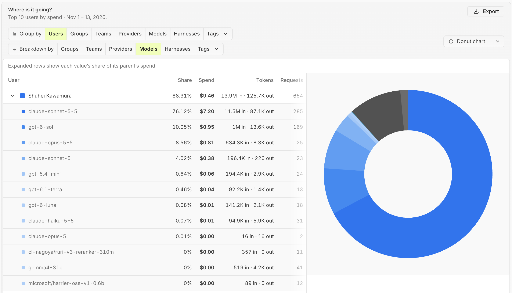
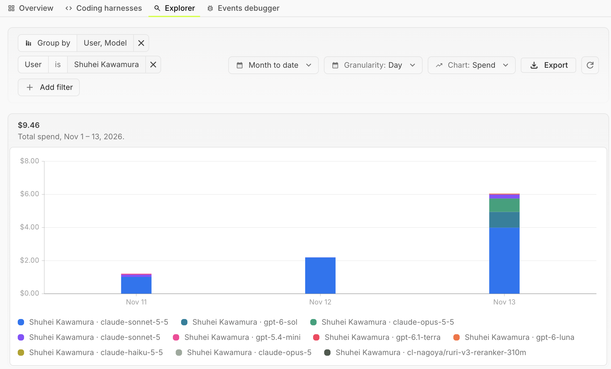
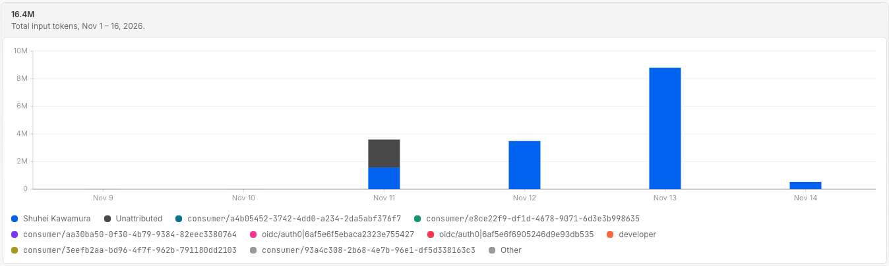
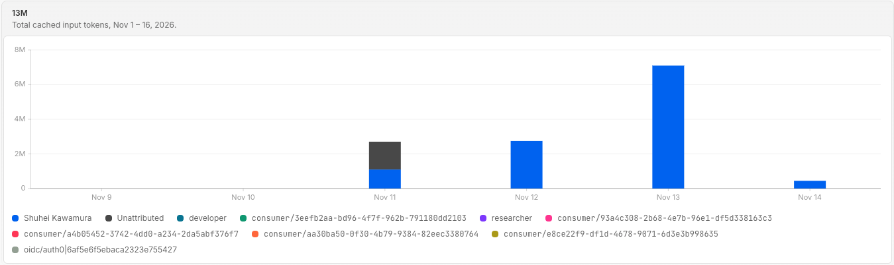
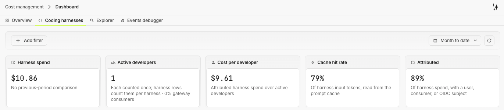
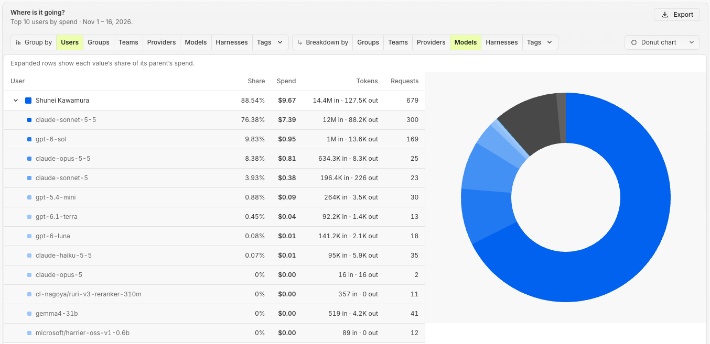
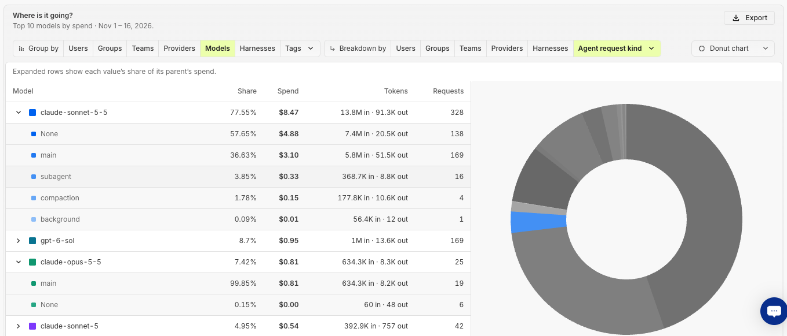
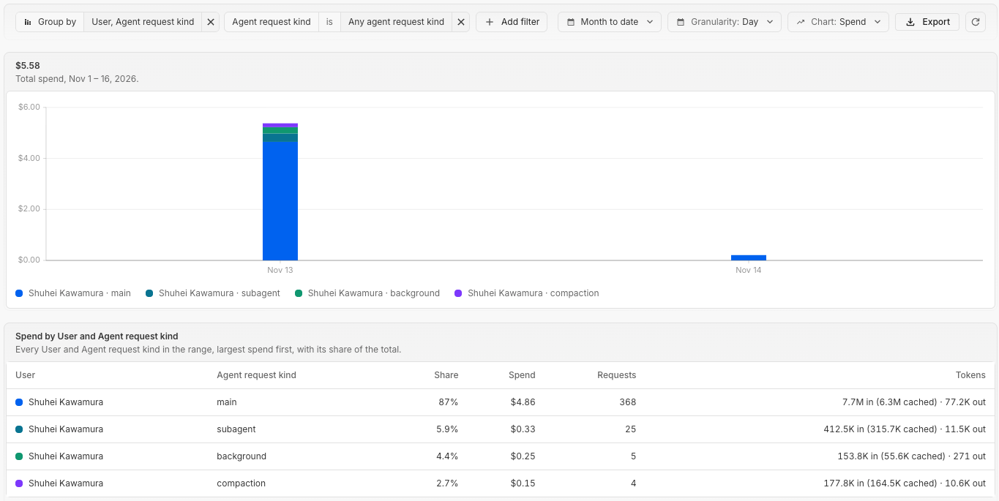
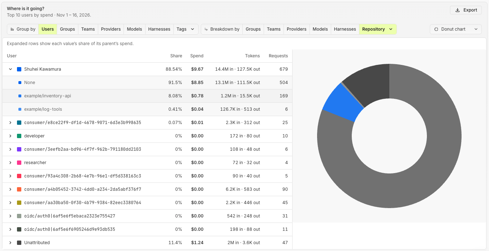

## はじめに

こんにちは🖐️今回はClaude CodeやCodexに代表されるコーディングエージェントをKong AI Gatewayを通して使った時のメリットの1つであるコスト管理について整理してみます。これらのエージェントをKong AI Gatewayを通すことで組織全体の利用量を様々な軸で分析したり、うまくAI駆動開発できているか？を分析してみます。

## AI Cost Management

AI Cost Managementは、Kong AI Gatewayを通るリクエストごとに使用量のイベントを記録し、ユーザーやチームに帰属させ、価格カタログで値付けしたうえでダッシュボードに出してくれるKong Konnectの機能であり、2027年11月にリリースされました。

https://developer.konghq.com/ai-cost-management/

主な機能は以下の通りです。

- Dashboard: 期間内の支出の推移と、ユーザーやモデルなどの内訳を把握するための機能
- Explorer: 1つのディメンションでグルーピングした、支出・リクエスト数・トークン数の推移を把握するための機能
- Events debugger: 個々の使用量イベントの中身を詳細に把握するための機能
- Budgets: 予算と、しきい値ごとの通知（メール、Slack）を行うための機能
- Attribution: 分析のための属性を管理するための機能
- Price catalog: モデルごとの単価や組織ごとの上書きを行うための機能
- Exports: 使用量イベントやFOCUS形式のコストデータを、CSV / Parquetで出力する機能

Dashboardの「Where is it going?」では、Users、Groups、Teams、Providers、Models、Harnesses、Tagsのどれかで支出を分解し、2つ目のディメンションも重ねることができます。


_ユーザー/モデル軸でのコスト分析の様子_

Explorerでは、Spend、Requests、Input tokens、Cached input tokens、Output tokensのいずれかを時系列で見ることができます。


_ユーザー/モデル軸で使用量を時系列にみた様子_

### なぜGatewayレイヤーで見るのか

Claude Code自体にも`/usage`やOpenTelemetryでのメトリクス出力があります。Claude EnterpriseやClaude Consoleであれば、Anthropic側のアナリティクスでユーザー別の利用状況を見ることができるでしょう。一方で、Microsoft Foundry、Amazon Bedrock、Google Agent Platformなどパブリッククラウド経由の従量課金で使うケースも多々あるでしょう。その場合は、Anthropicのアナリティクスの対象外です。この場合、ユーザー別に利用量を見るためにはOpenTelemetryかLLM Gatewayを使う、とClaude Codeのドキュメントにも記載があります[^1]。

[^1]: [https://code.claude.com/docs/en/costs](https://code.claude.com/docs/en/costs)

Gatewayで見る良い所は、Claude Code以外のエージェント（今回はCodex）も同じ画面で参照できることと、エージェントにLLMの鍵を持たせずに、Konnectが発行したVirtual Keyで利用者を識別できることです。また、Claude Codeの`/usage`の金額は、手元でトークン数に定価を掛けた見積もりなので、Price Catalogの単価で値付けされるKonnect側の数字とは一致しません。

## 前提

今回の内容は、以下の前提で進めます。

- Claude CodeとCodexが、すでにKong AI Gateway（2.3）経由でLLMを呼び出せていること
- AI Gatewayのデータプレーンを、Docker上の`kong/kong-ai-gateway:2.3.0`で動かしていること
- Kong IdentityのDirectoryに、Virtual Keyの帰属先とするユーザーが存在していること

尚、私の環境ではMicrosoft Foundry上のClaudeとGPTを使っています。Claude CodeをKong AI Gateway経由にする手順は、以下のドキュメントを参照してください。

https://developer.konghq.com/ai-gateway/use-claude-code-with-ai-gateway-azure/

## やることの全体像

AI Cost Managementを有効に使うためにやることと、それぞれで見えるようになるものは以下の通りです。

| やること | 見えるようになるもの |
|---|---|
| 1. Auth Strategyで利用者を特定する | 誰が利用しているか |
| 2. Price Catalogで価格を付ける | どれくらい利用しているか |
| 3. データプレーンでタグの取り込みを有効にする | 特になし（4と5の前提条件） |
| 4. AttributionでClaude Code / Codexを有効にする | セッションやサブエージェント、リクエストの種類 |
| 5. 足りないタグを`ai-cost-`ヘッダーで送る | リポジトリ、ブランチ、プロジェクト、CIなど |
| 6. BudgetsとNotification channelsを設定する | 使いすぎの通知 |

ちなみに、Harnesses（Claude CodeとCodexの区別）は、1と2だけの状態で追加の設定なしで分けて見ることができます。ゲートウェイに届くUser-Agent（Claude Codeは`claude-cli/...`、Codexは`codex_exec/...`、対話時は`codex_cli_rs/...`）でどうやら判定しているようです。

### 1. Auth Strategyで利用者を特定する

まずは、利用者の特定です。AI Cost Managementがユーザー（`subject`）を決めるのは、以下のいずれかがリクエストに付いている場合です。

- Kong IdentityのPrincipal
- AI Consumer
- `openid-connect-credential-claim`のAuth Strategyで検証したトークンの`sub`クレーム

どれも、AI Modelに付けたAuth Strategyで評価されます
今回は、KonnectのVirtual Keyを検証してPrincipalに解決するAuth Strategyを使いました。

```yaml:konnect/ai-gateway/50-model-foundry.yaml
ai_gateway_auth_strategies:
  - ref: virtual-key
    ai_gateway: !ref aigw#id
    name: virtual-key
    display_name: Konnect Virtual Key (bearer)
    type: key-auth
    config:
      key_names: [x-api-key]
      key_in_header: true
      key_in_query: false
      hide_credentials: true
      identity_realms: []
      principals:
        enabled: true
        directory: default
        error_on_miss: true
```

必要箇所のみ抜粋しています。このAuth StrategyをAI Modelの`access.auth_strategies`に指定します。

ここは地味にハマりポイントがありました。

まずClaude Codeは、`ANTHROPIC_API_KEY`に設定した値をAnthropic APIと同じ`x-api-key`ヘッダーで送るので、Virtual Keyを`ANTHROPIC_API_KEY`に設定するだけで済みます（`ANTHROPIC_AUTH_TOKEN`に設定すると`Authorization: Bearer`で送られるので、同じく401になります）。一方で、CodexはOpenAI形式のクライアントなので、`env_key`に指定した環境変数の値を`Authorization: Bearer`で送ります。そのため、Codexの設定ファイル（`~/.codex/config.toml`）で、`env_http_headers`を使って同じ値を`x-api-key`ヘッダーにも載せています（必要箇所のみ抜粋しています）。

```toml:~/.codex/config.toml
[model_providers.kong]
env_key = "KONNECT_VIRTUAL_KEY"
env_http_headers = { "x-api-key" = "KONNECT_VIRTUAL_KEY" }
```

Virtual Key自体は、Konnectの**AI** > **Access Management** > **Virtual Keys**から、holderにユーザーを選んで発行します。表示されたSecretはKonnect側にハッシュしか残らず再表示できないので、ここで控えておきます。

また、ユーザーの次の粒度として、GroupsとTeamsがあります。Groupsは、PrincipalのKong Identityのグループ、AI Consumerのconsumer group、`openid-connect`のAuth StrategyのJWTの`group` / `groups`クレームから付きます。Teamsは、組織図（`external_id`、`manager_external_id`などを持つCSV）をアップロードすると、上司と部下の関係から作られます。組織として見たい場合は、このあたりも揃えておくと良いでしょう。

### 2. Price Catalogで価格を付ける

続いて、価格です。イベントの金額は、リクエストの時点でそのモデルに価格が付いているかで決まり、付いていないと$0になって`Unpriced calls`として別に数えられます。私の環境では、FoundryのClaude（`claude-sonnet-5-5`, `claude-sonnet-5`）はPrice Catalogにすでに載っていました。載っていないモデルを使いたい場合は、**Cost Management** > **Price Catalog** > **Add override** > **Custom rate**で単価を入れることができます。例えば、内部で推論用のGPUサーバーにLLMをホストしており、社内にチャージバックして使わせるようなケースではこのパターンに当てはまるでしょう。

https://developer.konghq.com/ai-cost-management/price-catalog/

Custom rateには、Base input、Outputのほかに、Cache reads、Cache writes、1-hour cache writes、Reasoningを個別に設定することができます。Claude Codeはプロンプトキャッシュをかなり使うので、ここが入っていないとキャッシュ分のコストが正しく算出することができません。また、何かしらの契約で一律の割引がある場合は、プロバイダー単位のPercentage off overrideも使うことができます。

価格については、以下の順で最初に見つかったものが使われます。

1. AI Modelのtargetに設定したコスト（`input_cost`など）
2. モデルのCustom rate
3. プロバイダーのPercentage off
4. カタログの定価

### 3. データプレーンでタグの取り込みを有効にする

ここからは、Claude CodeやCodexの使い方を見るための設定となります。AI Cost Managementには、`ai-cost-`で始まるリクエストヘッダーをタグとして取り込む仕組みと、ツールがネイティブで送っているヘッダーを標準のタグに変換する仕組みがあります。どちらも、データプレーンで`KONG_CUSTOM_PLUGIN_STREAMING_ENABLED=on`が設定されていないと取り込むことができません。

```yaml:docker-compose.yaml
services:
  kong:
    image: kong/kong-ai-gateway:2.3.0
    environment:
      KONG_CUSTOM_PLUGIN_STREAMING_ENABLED: "on"
```

Dedicated Cloud GatewaysのAI Gateway 2.xではデフォルトで有効となっていますが、今回のように自分でデータプレーンを動かしている場合は明示的に設定する必要があります。この設定がないゲートウェイで、次のAttributionを有効にしようしたときにエラーとなります。

### 4. AttributionでClaude Code / Codexを有効にする

次に、Konnectの**AI** > **Cost Management** > **Attribution**を開きます。

https://developer.konghq.com/ai-cost-management/attribution/

**Integrations**タブで連携先（今回はClaude CodeとCodex）を選び、表示される手順に従います。また、**Turn it on in your gateways**の下にゲートウェイごとのトグルがあるので、使うAI Gatewayで有効にします。

これで、Claude CodeとCodexが送っているネイティブのヘッダーが、標準のタグに自動で変換されるようになります。Integrationsのページによると、自動で付くタグは以下の通りです。

| ツール | 自動で付くタグ | `ai-cost-`ヘッダーで足すタグ |
|---|---|---|
| Claude Code | `agent-session`, `agent-id`, `agent-parent`, `agent-request-kind`, `agent-type` | `scm-provider`, `scm-repository`, `scm-branch` |
| Codex | `agent-session`, `agent-request-kind`, `scm-repository`, `scm-provider`, `scm-commit`, `agent-id`, `agent-parent`, `agent-type` | `scm-branch`, `project` |

https://developer.konghq.com/ai-cost-management/integrations/

Claude Code側のドキュメントを見ると、ゲートウェイ向けに以下のヘッダーを送っていることがわかります。

- `x-claude-code-session-id` - Claude Codeのセッションの識別子
- `x-claude-code-agent-id` - リクエストを出したサブエージェントの識別子（サブエージェントからのリクエストのみ）
- `x-claude-code-parent-agent-id` - そのエージェントを起動した親エージェントの識別子（ネストしたエージェントのみ）
- `x-claude-code-request-class` - リクエストの種類（`main`、`subagent`、`workflow`、`compaction`、`background`）
- `x-claude-code-agent-type` - サブエージェントの種類（`Explore`、`Plan`、`general-purpose`、`custom`など）

https://code.claude.com/docs/en/llm-gateway-protocol

ここで注意が必要なのが、後ろの2つです。これらはgateway hint headersという扱いで、`ANTHROPIC_BASE_URL`でゲートウェイに向けている場合はデフォルトで送られません。Claude Code 2.1.273以降を利用し`CLAUDE_CODE_GATEWAY_HINT_HEADERS=1`を設定する必要があります。名前から推察するに、`agent-request-kind`と`agent-type`はこの2つのヘッダーから作られているはずなので、Claude Code側でこの環境変数を設定しないと、Attributionを有効にしてもリクエストの種類やサブエージェントの種類は取れないのだと思います。

### 5. 足りないタグを`ai-cost-`ヘッダーで送る

リポジトリやブランチ、プロジェクトのように、ツールが自動で送ってくれない情報は、`ai-cost-`ヘッダーで足します。接頭辞を除いた部分がタグのキーになり、例えば`ai-cost-project: kong`と設定するとprojectタグが`kong`となります。

Claude Codeは`ANTHROPIC_CUSTOM_HEADERS`に設定したヘッダーをリクエストに載せてくれるので、例えば少々面倒ですがリポジトリの`.claude/settings.json`に以下のように書いておけば、そのリポジトリで動かしたClaude Codeの利用量にタグが付与されます。

```json:.claude/settings.json
{
  "env": {
    "ANTHROPIC_CUSTOM_HEADERS": "ai-cost-scm-provider: github\nai-cost-scm-repository: my-org/my-app\nai-cost-project: my-app"
  }
}
```

### 6. BudgetsとNotification channelsを設定する

最後に、予算と通知です。先に**Notification channels**でメールやSlackの通知先を作っておき、**Budgets** > **New budget**で予算を作ります。

https://developer.konghq.com/ai-cost-management/budgets/

予算には「Pooled」（範囲全体で1つの上限）と「Individual」（`each`、指定したフィールドの値ごとに同じ上限）の2種類があり、Individualで`subject`ごとに分ければ、全ユーザーに同じ月額の上限を一括で設定することができます。スコープはprovider、model、tag、team、subjectなどでフィルタできるので、例えば特定のプロジェクトのタグに絞った予算も作れます。しきい値は上限に対する%で最大10個まで持て、100%を超える値（例えば120%）も設定できるので、「50%、75%、100%、120%でSlackに通知」といった設定も可能です。

目安としては、Claude Codeのドキュメントに、エンタープライズ環境では開発者1人あたり月$150〜250程度[^2]という数字が載っているので、最初はこのあたりを基準とし、実績を見ながら調整していくと良いと思います。前述した通り、Budgetsは現状では通知のみを担い、ブロックしません。ブロックしたい場合は、AI Gateway側のレート制限など別の仕組みと組み合わせる必要があります。

[^2]: https://code.claude.com/docs/en/costs

## AI駆動開発の文脈では何を見るか

ここまで設定すると、「誰が」「どのモデルで」「どのエージェントから」に加えて、使われ方を見る材料が揃います。問いごとに、どこを見れば良いかを整理しておきます。

### プロバイダーキャッシュは効いているか？

Claude Codeは、毎回の会話履歴やツールの結果を丸ごとLLMに送り直すので、プロバイダー側のプロンプトキャッシュが効いているかどうかでコストが大きく変わってきます。ExplorerでChartをInput tokensとCached input tokensで切り替えて見比べると、全体としてどれくらいキャッシュから読めているかがわかりますし、Events debuggerでは`input_text_tokens`、`input_cache_read_tokens`、キャッシュ分のコスト（`reported_cache_cost`）まで確認できます。


_総入力トークン長_


_総入力トークン長（キャッシュ）_

これを見ると、総入力の約16Mトークンに対してキャッシュで処理されたものが13Mトークンあり、80%近くがキャッシュのトークン単価で利用されていることが確認できます。尚、まとまった全体の傾向はDashboard > Coding Harnessesからも確認することができます。（前述した件はそれをさらに人単位でブレークダウンしたい時に有効に活用できるでしょう）


_総入力トークン長とキャッシュの全体傾向_

これは、使い方の問題だけでなく、ゲートウェイの設定の健全性チェックにも繋がります。ゲートウェイのポリシーで本文を修正したりJSONの順番が担保されない場合は、キャッシュが全損している可能性もあるので、ここはきちんと見ておくべきです。

### モデルの使い分けは適当か？

Claude Codeのドキュメントによると、ほとんどのコーディングタスクはSonnetで十分であり、Opusは複雑な設計判断や多段の推論に取っておき、単純なサブエージェントのタスクはHaikuに任せる、という使い分けが推奨されています[^3]。DashboardでUsersを1つ目、Modelsを2つ目のディメンションにすると、ユーザーごとのモデルの構成比が見ることができます。

[^3]: https://platform.claude.com/docs/en/about-claude/models/choosing-a-model


_ユーザーごとのモデル構成比_

また、`agent-request-kind`が取れていれば、`background`（セッションのタイトル生成などのサイドリクエスト）や`subagent`のリクエストが高いモデルで処理されていないかも同様に確認することができます。（例えば、Fable, Opusに`subagent`が含まれていないか？などが主な確認観点となります）


_モデルごとのタスク構成比_

### サブエージェントやコンパクションにどれだけ使っているか？

Explorerで`agent-request-kind`をGroup byすると、`main`、`subagent`、`compaction`、`background`ごとの比率を見ることができます。`compaction`の比率が高い場合は、`/clear`を挟まずに1つのセッションを長く使い続けている可能性があります。また、`agent-type`で見れば`Explore`や`Plan`、自作のサブエージェント（`custom`）のどれがコストを食っているかがわかりますし、`agent-session`で絞れば、特に重かったセッションをEvents debuggerで1件ずつ追いかけることもできます。冗長な出力をサブエージェント側に閉じ込めるのはむしろ推奨されている使い方なので、比率が自社の想定と合っているかを見る、くらいの使い方が良いと思います。


_タスク比率_

### どのリポジトリ・プロジェクトに使っているか？

5で足した`scm-repository`や`project`のタグでGroup byすれば、リポジトリやプロジェクトごとのコストが見えます。Budgetsのスコープにも使えるので、プロジェクト単位の予算管理にもつなげられます。


_リポジトリ単位の利用量のブレークダウン例_

### どのエージェントが合っているか？

Harnessesで、Claude CodeとCodexの利用量を並べて見ることができます。チームで複数のコーディングエージェントを試している段階であれば、同じ人・同じリポジトリでのエージェントごとのコストを比べられるので自社に適したハーネスを探索する際などは便利だと思います。ただし、コストが安い方が良いエージェントとは限らないので、ここで見えるのはあくまで判断材料の1つとなります。

## おわりに

今回は、Kong AI Gateway経由で使っているClaude CodeとCodexのコストをAI Cost Managementで見るために、やることとそれによって分析できることを整理してみました。ゲートウェイを通すだけでも使用量は記録されますが、利用者の特定、価格、タグの取り込みとAttributionの有効化まで揃えて、初めて「どう使われているか」が見えるようになるのがポイントだと思います。
